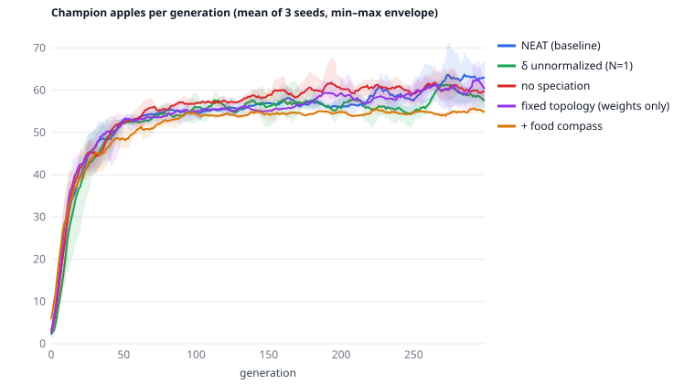

# Snake × NEAT

**NeuroEvolution of Augmenting Topologies applied to Snake, implemented from scratch with numpy only, with a live visualization of the evolving population.**


Every component is written from first principles: the game, the NEAT genome (historical markings,
structural mutations, crossover), speciation with explicit fitness sharing, the layered phenotype
evaluator, parallel evaluation and the GUI. The only third-party dependency is **numpy**. Everything else
comes from the Python standard library (Tkinter, multiprocessing, unittest). The project is managed with
**uv**.

| | |
|---|---|
| Held-out performance (15×15 board) | **60.4 ± 0.8 apples** per game (95 % CI, 500 unseen games), best game 88 |
| Time to 20 apples | about 8 generations |
| Generation time | about 0.2 s (150 genomes × 3 games, 24 cores) |
| Champion network | 24 inputs, 3 outputs, about 9 hidden neurons evolved from none |

## Documentation

| Document | Content |
|---|---|
| **[docs/theory.md](docs/theory.md)** | Formal model: MDP, observation map, policy class, NEAT operators, fitness estimator. Definitions, propositions and proofs, algorithm, complexity, statistical methodology. |
| **[docs/api.md](docs/api.md)** | CLI, Python API, hyperparameters, genome file format, training logs, reproducibility. |
| This README | Overview, quick start, interface, summary of the method and of the results. |

---

## Quick start

```bash
git clone https://github.com/CyberSnakeH/SnakeNeuroEvolution.git
cd SnakeNeuroEvolution
uv sync

uv run snake-neat                                     # GUI, evolution starts immediately
uv run snake-neat --view species                      # GUI, one snake per species
uv run snake-neat play runs/demo/champion.json        # watch the pre-trained champion
uv run snake-neat train --generations 300 --out runs/exp1        # headless: CSV log + genomes
uv run snake-neat eval runs/exp1/champion.json --episodes 500    # held-out evaluation, 95 % CI
uv run python -m unittest discover -s tests -v        # unit tests
uv run python experiments/ablation.py --generations 300          # ablation study
uv run python experiments/significance.py             # Welch tests on the ablation data
```

> **Python version.** The project pins the *system* interpreter (`.python-version` = 3.15,
> `python-preference = "system"`), because the Tk bundled with uv-managed Python builds has no Xft
> support and only renders bitmap fonts. Any Python ≥ 3.12 whose Tk is built with Xft works.

## The interface

**Champion view** (default):
- **board**: the best genome of the latest generation plays live. Its 8 vision rays are drawn: dashed
  when empty, red when the apple is seen, with an orange ring on the first body segment hit.
- **network**: the champion's topology. Inputs are labelled (`FR body` is the front-right ray, body
  channel), hidden neurons are arranged by topological depth, edge colour gives the sign of the weight
  and thickness its magnitude, and each node is coloured by its activation in real time. The chosen
  action is highlighted.
- **fitness**: best and mean fitness per generation.
- **speciation**: stacked areas of species sizes, one colour per species.

**All-species view**: one board per living species (up to 16), each showing the best individual of its
species, with a border in that species' colour from the speciation chart. Clicking a board displays
that species' network. Species appear and go extinct as evolution proceeds; pause evolution with
`Space` to let them finish their games.


Shortcuts: `Space` pauses or resumes evolution, `v` switches view, `+` / `-` change the replay speed.

---

## Method in brief

The full treatment, with proofs, is in [docs/theory.md](docs/theory.md).

**Control problem.** The board is $`\mathcal{G} = \{0, \dots, W-1\} \times \{0, \dots, H-1\}`$. A state
$`s = (\mathbf{c}, h, p, \eta)`$ holds the body, the heading $`h \in \mathbb{Z}/4\mathbb{Z}`$, the apple and the steps since
the last meal. Actions are relative, $`a \in \{0, 1, 2\}`$ (left, straight, right):

```math
h_{t+1} \equiv h_t + a_t - 1 \pmod{4}.
```

An episode ends on a collision, on a win, or on starvation after $`\eta_{\max} = WH`$ steps without eating.
Each episode terminates in at most $`\eta_{\max}(WH - L_0 + 1)`$ steps (theory, Proposition 2.4).

**Fitness.** The task specifies $`F = 1000\, A + T`$, with $`A`$ the apples eaten and $`T`$ the steps survived.
Splitting an episode at its meals into segments of lengths $`1 \le \tau_i \le \eta_{\max}`$ gives

```math
F = \sum_{i=1}^{A} \big( 1000 + \tau_i \big) + \tau_{A+1},
\qquad
1001\, A + 1 \;\le\; F \;\le\; (1000 + \eta_{\max})\, A + \eta_{\max} .
```

$`F`$ is therefore **not** lexicographic in (apples, survival). One more apple is guaranteed to win only
against snakes with at most 3 apples; beyond that, slow eaters collect up to $`\eta_{\max}`$ survival points
per apple. $`F / 1000`$ stays a close proxy for $`A`$ (theory, Proposition 2.6 and Remark 2.7).

**Observation.** Eight rays $`d_0, \dots, d_7`$ are cast in the snake's own frame. Each reports the inverse
distance to the wall and to the body, and a linear proximity to the apple, so $`\phi(s) \in [0, 1]^{24}`$. On a
square board, with $`\rho`$ the quarter turn,

```math
\phi(\rho \cdot s) = \phi(s) \qquad \text{for every state } s ,
```

so every policy $`\psi \circ \phi`$ is invariant under the rotation group $`C_4`$ (Proposition 3.4). $`\phi`$ is not
injective: the agent acts in a partially observable process.

**Policy class.** A genome $`g = (\mathcal{N}, \mathcal{C})`$ encodes a directed acyclic network. Activations are
$`x_v = \tanh\big(b_v + \sum_{u \to v} w_{uv} x_u\big)`$ and the action is the $`\arg\max`$ of the three outputs. Grouping
nodes by depth makes the forward pass exact with one dense product per layer,

```math
x_{L_k} \leftarrow \tanh\big( W_k\, x + b_k \big), \qquad k = 1, \dots, d_{\max}
```

(Proposition 4.4). Every variation operator preserves acyclicity (Proposition 5.1), and adding a node
changes the parent's function by at most $`\lvert w \rvert\, \lvert x_u \rvert^3 / 3`$ (Proposition 5.2).

**Speciation and selection.** The compatibility distance is

```math
\delta(g_1, g_2) = c_1 \frac{E}{N} + c_2 \frac{D}{N} + c_3\, \overline{W},
```

which is symmetric and bounded but not a metric (Proposition 6.2). Its threshold $`\delta_t`$ follows a
multiplicative controller toward $`K^\star = 10`$ species. With explicit fitness sharing, species $`S`$ receives

```math
n_S \approx N_{\mathrm{pop}} \frac{\bar F_S}{\sum_T \bar F_T}
```

offspring, rounded by largest remainders so that the total is exactly $`N_{\mathrm{pop}}`$ and $`\lvert n_S - q_S \rvert < 1`$
(Proposition 6.4).

**Fitness estimation.** Each genome plays $`K = 3`$ games, and within a generation all genomes share
the same seeds. This *common random numbers* scheme reduces the variance of every pairwise comparison
by $`2\,\mathrm{Cov}/K`$ (Proposition 7.3). Selecting the maximum of noisy estimates is biased upwards
(the optimizer's curse, Proposition 7.5), so elites are re-evaluated on fresh seeds every generation, and
reported results always use held-out seeds.

---

## Results

**Protocol.** 15×15 board, $`N_{\mathrm{pop}} = 150`$, $`K = 3`$, 300 generations. Each variant is trained with 3
seeds, and the final champion of each seed is measured on 200 held-out games. Each run takes about 50 s
on 24 cores. Raw data: `runs/ablation/results.json`.

**Reference performance.** The demo champion (`runs/demo/champion.json`) eats **60.4 ± 0.8 apples**
(95 % CI over 500 held-out games), with median 60 and maximum 88 (91 cells, 40 % of the board). Causes of
death: body 69 %, wall 26 %, starvation 4 %. A random snake eats about 0.1 apple per game.

**Ablation.** Welch tests against the baseline, with Welch–Satterthwaite degrees of freedom $`\nu`$ and
Holm–Bonferroni correction (`experiments/significance.py`, theory Section 10):

| Variant | test apples (mean of 3 seeds) | std. | $`t`$ | $`\nu`$ | $`p`$ | Holm $`\tilde p`$ | hidden nodes |
|---|---|---|---|---|---|---|---|
| **NEAT (baseline)** | **60.8** | 5.9 | | | | | 9.3 |
| δ unnormalized ($`N = 1`$) | 56.3 | 3.0 | 1.19 | 2.95 | 0.322 | 0.389 | 13.0 |
| no speciation | 54.2 | 1.3 | 1.90 | 2.19 | 0.187 | 0.389 | 6.0 |
| fixed topology (weights only) | 52.6 | 1.4 | 2.37 | 2.21 | 0.130 | 0.389 | 0 |
| + food compass | 50.6 | 1.0 | 2.96 | 2.11 | 0.092 | 0.367 | 7.0 |



**Reading.**
1. **No difference is statistically significant**, even before correction. With three seeds,
   $`\nu`$ lies between 2.1 and 3.0, and for $`\nu = 2`$ rejection at 5 % needs $`\lvert t \rvert > 4.30`$. The baseline ranks first, but the
   training curves overlap and all variants plateau at 55–62 apples. The honest conclusion is that on
   this task, complexification and speciation bring at most a modest gain. About ten seeds per variant
   would be needed to settle it.
2. **A network with no hidden layer is already strong**: about 52 apples. Thanks to the egocentric
   perception, a nearly linear policy suffices, and NEAT champions recruit only 5 to 13 hidden neurons.
   This is consistent with NEAT's premise of starting minimal.
3. **The food compass has the lowest score** and the most consistent curve below the others. A
   hypothesis, not tested here: an ever-present gradient towards the apple favours greedy paths that
   trap the snake sooner. The compass is off by default.
4. **The final champion is a noisy pick.** Training scores over the last 50 generations (60 to 62 apples)
   often exceed the test score of the single retained champion. Choosing among recent champions on a
   validation set would reduce this variance.
5. **The ceiling of about 60 apples comes from perception.** 69 % of deaths are self-collisions, typically
   self-trapping that eight local rays cannot anticipate (theory, Remark 3.6).

## Limitations and future work

- **Partial observability.** $`\phi`$ shows neither the shape of the body nor the tail. Possible additions:
  tail direction, a local $`k \times k`$ map, or reachability features such as the size of the free region
  ahead of each action.
- **No memory.** Recurrent connections are excluded to keep phenotypes acyclic. Allowing them would let
  the policy remember, for example, the last apple position.
- **Diluted topology term.** With 72 initial genes, adding one node changes $`\delta`$ by only about
  $`2/72 \approx 0.03`$, so speciation is driven mostly by weights. The "δ unnormalized" ablation probes this.
- **Fitness design.** The specified $`F`$ rewards slow eating (Proposition 2.6). A strictly lexicographic
  reward would need an apple bonus above $`\eta_{\max}(WH - L_0 + 1) = 50\,175`$.
- **Statistical power.** Three seeds per variant cannot separate the variants.

## Project layout

```
src/snake_neat/   game, genome, network, population, evaluation, persistence, GUI, CLI
tests/            15 unit tests (unittest)
experiments/      ablation study, significance tests, SVG learning curves
docs/             theory.md, api.md, GIFs and figures
runs/demo/        pre-trained champion and its held-out evaluation
runs/ablation/    raw ablation data
```

## Reference

K. O. Stanley and R. Miikkulainen. Evolving neural networks through augmenting topologies.
*Evolutionary Computation*, 10(2):99–127, 2002.
