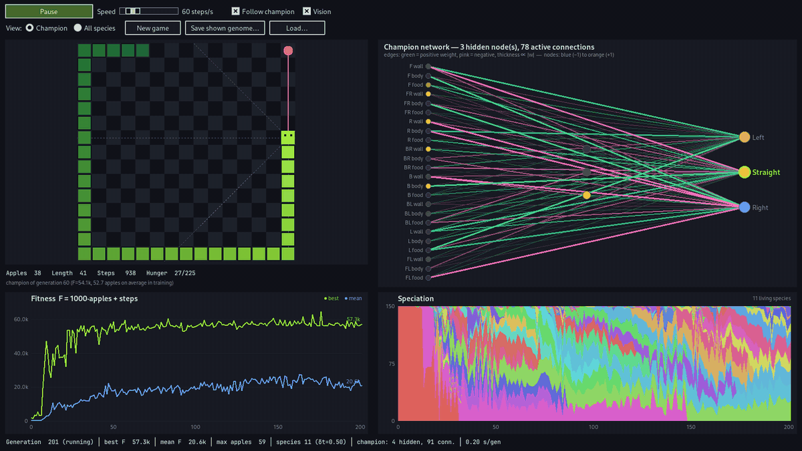
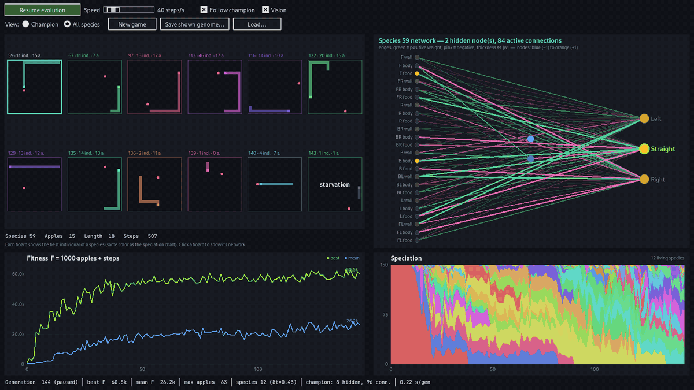

# Snake × NEAT

**NeuroEvolution of Augmenting Topologies applied to Snake, implemented from scratch with numpy only, with a live visualization of the evolving population.**



Every component is written from first principles: the game, the NEAT genome (historical markings, structural mutations, crossover), speciation with explicit fitness sharing, the layered phenotype evaluator, parallel evaluation, and the GUI. The only third-party dependency is **numpy**. Everything else comes from the Python standard library (Tkinter, multiprocessing, unittest). The project is managed with **uv**.

| | |
|---|---|
| Held-out performance (15×15 board) | **60.4 ± 0.8 apples** per game (95 % CI, 500 unseen games), best game 88 apples |
| Time to 20 apples | ≈ 8 generations |
| Generation time | ≈ 0.2 s (150 genomes × 3 games, 24 cores) |
| Champion network | 24 inputs → 3 outputs, ≈ 9 hidden neurons evolved from none |

---

## Contents

1. [Quick start](#quick-start)
2. [The interface](#the-interface)
3. [Problem formulation](#1-problem-formulation)
4. [Representation](#2-representation)
5. [The NEAT algorithm](#3-neat)
6. [Code layout](#4-code-layout)
7. [Experiments](#5-experiments)
8. [Limitations and future work](#6-limitations-and-future-work)

---

## Quick start

```bash
git clone https://github.com/CyberSnakeH/SnakeNeuroEvolution.git
cd SnakeNeuroEvolution
uv sync

uv run snake-neat                                     # GUI, evolution starts immediately
uv run snake-neat --view species                      # GUI, one snake per species
uv run snake-neat play runs/demo/champion.json        # watch the pre-trained champion
uv run snake-neat train --generations 300 --out runs/exp1   # headless: CSV log + genomes
uv run snake-neat eval runs/exp1/champion.json --episodes 500   # held-out evaluation, 95 % CI
uv run python -m unittest discover -s tests -v        # unit tests
uv run python experiments/ablation.py --generations 300       # ablation study (section 5)
```

Common options: `--width/--height` (board size, default 15×15), `--pop` (population, 150), `--episodes`
(games per evaluation, 3), `--species` (target number of species, 10), `--compass` (extra inputs, see
§2.2), `--workers` (processes, 0 = all cores), `--seed`.

> **Python version.** The project pins the *system* interpreter (`.python-version` = 3.15,
> `python-preference = "system"`). The Tk bundled with uv-managed Python builds is compiled without
> Xft and can only render bitmap fonts. Any Python ≥ 3.12 with a Tk built with Xft works.

## The interface

**Champion view** (default):
- **board**: the best genome of the latest generation plays live. Its 8 vision rays are drawn: dashed
  for empty, red when the apple is seen, an orange ring on the first body segment hit.
- **network**: the champion's topology. Inputs are labelled (`FR body` = front-right ray, body channel).
  Hidden neurons are arranged by topological depth. Edge colour shows the sign of the weight and
  thickness shows |w|. Each node is coloured by its activation in real time, and the chosen action is
  highlighted.
- **fitness**: best and mean fitness per generation.
- **speciation**: stacked area chart of species sizes. One colour per species, the thickness of a band
  is the size of that species.

**All-species view**: a mosaic with one board per living species, up to 16. Each board shows the best
individual of its species, and its border uses that species' colour in the speciation chart. Click a
board to display that species' network. Species appear and go extinct as evolution proceeds. At about
0.2 s per generation this turnover is fast, so pause evolution to let the species finish their games.



Shortcuts: `Space` pauses or resumes evolution, `v` switches view, `+` / `-` change replay speed. The
**Save shown genome…** button exports the genome currently displayed, including a selected species'
champion.

---

## 1. Problem formulation

The board is the grid

```math
\mathcal{G} = \{0, \dots, W-1\} \times \{0, \dots, H-1\}.
```

A state is $`s = (\mathbf{c}, h, p, \eta)`$: the body $`\mathbf{c} = (c_0, \dots, c_{L-1}) \in \mathcal{G}^L`$ with head $`c_0`$, the heading $`h \in \mathbb{Z}/4\mathbb{Z}`$, the apple $`p \in \mathcal{G}`$ and the hunger counter $`\eta \in \mathbb{N}`$. The game is a Markov decision process, deterministic except for the apple, which is drawn uniformly among free cells:

```math
p \sim \mathcal{U}\big(\mathcal{G} \setminus \{c_0, \dots, c_{L-1}\}\big).
```

An episode ends on collision (wall or body), on starvation ($`\eta \ge \eta_{\max}`$ steps without eating, with $`\eta_{\max} = W H`$ by default), or on a win (board full).

We search for a policy $`\pi_\theta : \phi(s) \mapsto a`$ that maximizes the expected fitness

```math
F(\theta) = \mathbb{E}\big[\, 1000 \cdot A + T \,\big],
```

where $`A`$ is the number of apples eaten and $`T`$ the number of steps survived.

**Lexicographic order.** Between two apples the snake survives at most $`\eta_{\max}`$ steps, and $`\eta_{\max} \le WH < 1000`$. Hence, for two episodes,

```math
A_1 > A_2 \;\Longrightarrow\; 1000\,A_1 + T_1 > 1000\,A_2 + T_2 ,
```

so $`F`$ ranks apples first and uses survival only to break ties. Survival without eating, for example circling forever, is capped at $`\eta_{\max}`$. This removes the degenerate "loop forever" strategy.

## 2. Representation

### 2.1 Relative actions
The action set is $`a \in \{0, 1, 2\}`$ (left, straight, right), with heading update

```math
h_{t+1} = h_t + a_t - 1 \pmod 4 .
```

The U-turn, which is always fatal, cannot be expressed. The network has 3 outputs $`y \in \mathbb{R}^3`$ and the action is $`a = \arg\max_k y_k`$.

### 2.2 Egocentric observation
Let $`f = (f_x, f_y)`$ be the heading vector and $`r = (-f_y, f_x)`$ its clockwise rotation (the snake's right). Eight rays are cast from the head along

```math
d_k \in \{\, f,\; f + r,\; r,\; r - f,\; -f,\; -f - r,\; -r,\; f - r \,\}, \qquad k = 0, \dots, 7,
```

that is forward, forward-right, …, forward-left in the **snake's own frame**. Along ray $`k`$, let $`t^{\text{wall}}_k`$ be the first step outside the board, and $`t^{\text{body}}_k`$, $`t^{\text{food}}_k`$ the first step that hits a body segment or the apple ($`+\infty`$ if none). Each ray contributes three features:

```math
\phi_{3k} = \frac{1}{t^{\text{wall}}_k}, \qquad
\phi_{3k+1} = \frac{1}{t^{\text{body}}_k}, \qquad
\phi_{3k+2} = \begin{cases} 1 - \dfrac{t^{\text{food}}_k - 1}{\max(W, H)} & \text{if } t^{\text{food}}_k < \infty, \\[4pt] 0 & \text{otherwise,} \end{cases}
```

with the convention $`1/\infty = 0`$. This gives $`\phi(s) \in [0, 1]^{24}`$.

**Why egocentric?** When $`W = H`$, the cyclic group $`C_4`$ of board rotations acts on states, and the optimal policy is equivariant under it. Because $`\phi`$ is expressed in the snake's frame,

```math
\phi(\rho \cdot s) = \phi(s) \qquad \forall \rho \in C_4 ,
```

which is checked by `test_rotation_invariance_of_observation`. Combined with relative actions, one learned behaviour serves all four headings, which cuts the behaviour space to discover by a factor of $`|C_4| = 4`$. Inverse distances give a sharp signal when danger is close, while food is encoded linearly so it stays detectable from afar.

`--compass` adds two inputs, the head→apple vector $`e = p - c_0`$ projected on the snake's axes:

```math
\phi_{24} = \frac{\langle e, f \rangle}{\max(W, H)}, \qquad \phi_{25} = \frac{\langle e, r \rangle}{\max(W, H)} .
```

With rays only, the apple is seen only when it is aligned with one of the 8 directions. Section 5 measures the effect of this extra information.

## 3. NEAT

### 3.1 Genome and historical markings
A genome is a pair $`g = (\mathcal{N}, \mathcal{C})`$. Each node $`v \in \mathcal{N}`$ is an input, output or hidden unit with a bias $`b_v`$. Each connection gene is a tuple

```math
(u \to v,\; w_{uv},\; \text{enabled},\; \iota) \in \mathcal{C},
```

where $`\iota`$ is its **innovation number**. Innovation numbers come from a global registry keyed by the pair $`(u, v)`$: the same structure always carries the same number, so two arbitrary topologies are aligned in $`O(|\mathcal{C}|)`$ without any graph matching. A node created by the $`k`$-th split of connection $`\iota`$ gets the canonical identifier $`(\iota, k)`$.

**Initial population**: the minimal topology, with all 24 inputs wired to the 3 outputs ($`24 \times 3 = 72`$ genes) and no hidden node. Complexity grows only when selection rewards it, which is the *complexification* principle of NEAT.

### 3.2 Mutations
**Weights and biases.** With probability $`0.8`$ per genome, each gene is touched with probability $`0.5`$, then updated as

```math
w \leftarrow \operatorname{clip}_{[-8,\,8]}\!\big(w'\big), \qquad
w' = \begin{cases} w + \varepsilon, \;\; \varepsilon \sim \mathcal{N}(0, 0.4^2) & \text{with probability } 0.9, \\ \tilde w \sim \mathcal{N}(0, 1) & \text{with probability } 0.1 . \end{cases}
```

**Structural mutations.**
- **Add node** ($`p = 0.03`$). A connection $`u \to v`$ of weight $`w`$ is disabled and replaced by $`u \to h`$ (weight $`1`$) and $`h \to v`$ (weight $`w`$). Since $`\tanh(x) \approx x`$ for small $`x`$, the behaviour is almost preserved.
- **Add connection** ($`p = 0.10`$). A random edge $`u \to v`$ is added only if $`u`$ is not reachable from $`v`$, so that no cycle is created. The check covers every gene, including disabled ones, because they may be re-enabled later. The network is therefore always a DAG.
- **Toggle** enabled/disabled ($`p = 0.01`$).

### 3.3 Crossover
Let $`g_1`$ be the fitter parent. Homologous genes (same $`\iota`$) are drawn uniformly from either parent. Disjoint and excess genes are taken from $`g_1`$. A gene disabled in either parent stays disabled with probability $`0.75`$. The child inherits the *structure* of $`g_1`$, which preserves acyclicity with no extra check.

### 3.4 Speciation and fitness sharing
The compatibility distance between two genomes is

```math
\delta(g_1, g_2) = c_1 \frac{E}{N} + c_2 \frac{D}{N} + c_3 \overline{W},
\qquad N = \max\big(|\mathcal{C}_1|, |\mathcal{C}_2|\big),
```

where $`E`$ is the number of excess genes, $`D`$ the number of disjoint genes, and $`\overline{W}`$ the mean absolute weight difference of homologous genes. We use $`c_1 = c_2 = 1`$ and $`c_3 = 0.4`$. A genome joins the first species $`S`$ whose representative $`g_S`$ (a random member of the previous generation) satisfies $`\delta(g, g_S) < \delta_t`$.

The threshold is **controlled multiplicatively** toward a target number of species $`K^\star = 10`$:

```math
\delta_t \leftarrow \begin{cases} \delta_t\,(1 - \alpha) & \text{if } K < K^\star, \\ \delta_t\,(1 + \alpha) & \text{if } K > K^\star, \end{cases} \qquad \alpha = 0.05 .
```

Unlike an additive step, this controller does not depend on the scale of $`\delta`$.

**Explicit fitness sharing.** The adjusted fitness of an individual $`i \in S`$ is

```math
f'_i = \frac{f_i}{|S|}, \qquad \text{hence} \qquad \sum_{i \in S} f'_i = \bar f_S ,
```

and species $`S`$ receives

```math
n_S = N_{\text{pop}} \cdot \frac{\bar f_S}{\sum_{T} \bar f_T}
```

offspring, rounded with the largest-remainder method so that $`\sum_S n_S = N_{\text{pop}}`$ exactly. A species cannot grow merely because it is large. This protects a structural innovation while its weights are being tuned.

The rest of reproduction follows the paper:
- only the top 25 % of a species reproduce;
- the champion of every species with at least 5 members is copied unchanged;
- a species that has not improved for 20 generations goes extinct, except the 2 best ones and the one holding the global champion;
- 75 % of offspring come from crossover, 1 % of them between species, and every offspring is then mutated.

### 3.5 Phenotype: layered forward pass
Define the depth of a node by $`d(v) = 0`$ for an input and

```math
d(v) = 1 + \max_{(u \to v) \in \mathcal{C}_{\text{on}}} d(u)
```

otherwise ($`d(v) = 1`$ if $`v`$ has no enabled predecessor), computed with Kahn's topological sort. Let $`L_k = \{ v : d(v) = k \}`$. Nodes of $`L_k`$ only depend on strictly shallower nodes, so the forward pass is exactly

```math
x_{L_k} \leftarrow \tanh\!\big( W_k\, x + b_k \big), \qquad k = 1, \dots, d_{\max},
```

with a dense $`W_k \in \mathbb{R}^{|L_k| \times |\mathcal{N}|}`$. This takes $`d_{\max}`$ numpy matrix-vector products, costing $`O(d_{\max} |\mathcal{N}|^2)`$ flops, instead of a Python loop over nodes. Exact equality with the recursive definition is checked by `test_layered_forward_equals_recursive_definition` on 20 heavily mutated random networks. Note that $`\tanh(x) = 2\sigma(2x) - 1`$ belongs to the same family as the steepened sigmoid $`\sigma(4.9x)`$ of the original paper.

### 3.6 Evaluation and variance control
Fitness is a random variable, because the apple is placed at random. The estimator used at generation $`n`$ is

```math
\hat F_n(\theta) = \frac{1}{K} \sum_{j=1}^{K} \big( 1000\, A(\theta, \omega_{n,j}) + T(\theta, \omega_{n,j}) \big), \qquad K = 3,
```

where $`\omega_{n,j}`$ are the random seeds of the episodes. Three measures control its variance:
1. **Averaging** over $`K`$ games.
2. **Common random numbers**: within a generation, every genome plays the *same* seeds $`\omega_{n,1}, \dots, \omega_{n,K}`$. Comparing two individuals then measures their policies rather than the luck of the draws, since $`\operatorname{Var}(\hat F_n(\theta_1) - \hat F_n(\theta_2))`$ is reduced by the positive correlation between the two estimates.
3. **Re-evaluating elites**: the seeds change every generation and a copied elite is evaluated again. Otherwise the retained champion would be $`\max_i \hat F(\theta_i)`$, an estimator biased upwards, since $`\mathbb{E}[\max_i \hat F(\theta_i)] \ge \max_i F(\theta_i)`$ (the *winner's curse*), and the population could overfit one particular apple sequence.

Evaluation is distributed over all cores with `multiprocessing`. It uses the *spawn* context, which is safe alongside the GUI thread. The performance reported in §5 is measured on **seeds never used during training**.

## 4. Code layout

```
src/snake_neat/
  config.py       hyperparameters (GameConfig, NEATConfig)
  game.py         Snake environment, ray casting, observation φ
  genome.py       genes, historical markings, mutations, crossover, distance δ
  network.py      genome → layered network compiler (numpy)
  population.py   speciation, fitness sharing, offspring allocation, stagnation, elitism
  evaluation.py   fitness, episodes, parallel evaluation, benchmark with 95 % CI
  persistence.py  JSON save / load of genomes
  gui.py          Tkinter interface
  cli.py          gui / play / train / eval commands
tests/            15 unit tests (unittest)
experiments/      ablation study and SVG learning-curve plot
runs/demo/        pre-trained champion (300 generations) and its held-out evaluation
runs/ablation/    raw ablation data
```

## 5. Experiments

**Protocol.** 15×15 board, population $`N_{\text{pop}} = 150`$, $`K = 3`$ games per evaluation, 300 generations, 3 independent
seeds per variant. Each training run takes about 50 s on 24 cores. We measure the champion of the last
generation on **200 test games** whose seeds were never used in training. Reproduce with
`uv run python experiments/ablation.py --generations 300 --seeds 0 1 2`. The raw data is in
`runs/ablation/results.json`.

### 5.1 Reference performance
The demo champion (`runs/demo/champion.json`, seed 0, 300 generations) scores **60.4 ± 0.8 apples** over
$`n = 500`$ test games, where the 95 % confidence interval is

```math
\bar A \pm 1.96\, \frac{s_A}{\sqrt{n}} = 60.4 \pm 0.8 .
```

The median is 60 and the best game reaches 88 apples, a length of 91 cells,
or 40 % of the board. Causes of death: body 69 %, wall 26 %, starvation 4 %. A random snake eats about
0.1 apple per game. About **8 generations** are enough to exceed 20 apples.

### 5.2 Ablation

| Variant | test apples (mean of 3 seeds) | std. across seeds | Welch t vs baseline | champion hidden nodes |
|---|---|---|---|---|
| **NEAT (baseline)** | **60.8** | 5.9 | — | 9.3 |
| δ unnormalized ($`N = 1`$) | 56.3 | 3.0 | 1.2 | 13.0 |
| no speciation | 54.2 | 1.3 | 1.9 | 6.0 |
| fixed topology (weights only, 24→3) | 52.6 | 1.4 | 2.4 | 0 |
| + food compass (26 inputs) | 50.6 | 1.0 | 3.0 | 7.0 |


**Critical reading.**

**1. The full configuration comes first, but the gap is not statistically established.** With
$`n_1 = n_2 = 3`$ seeds per variant, Welch's statistic

```math
t = \frac{\bar A_1 - \bar A_2}{\sqrt{s_1^2 / n_1 + s_2^2 / n_2}}
```

has about $`\nu \approx 2.2`$ degrees of freedom, and it does not reach the 5 % threshold for any
variant: that would need $`t \gtrsim 4`$. The training curves overlap widely, and every variant reaches a
plateau of 55–62 apples within about 100 generations. The careful conclusion is that **on this
problem, topological complexification and speciation bring at most a modest gain**. At least 10 seeds
per variant would be needed to decide.

2. **A perceptron with no hidden layer (24→3) is already very strong.** With a well-designed egocentric
   perception, a nearly linear policy eats about 50 apples. This is the premise of NEAT: start minimal,
   complexify only when selected. NEAT champions indeed recruit only 5 to 13 hidden neurons.
3. **The compass hurts performance**, and it is the clearest effect: low variance, and a curve
   consistently below the others after 100 generations. A hypothesis, not tested here: an always-available
   gradient towards the apple favours a greedy straight-line policy that traps the snake sooner. With
   rays only, the snake has to sweep the board, which keeps it more orderly. The compass is therefore off
   by default.
4. **Picking the final champion is noisy.** The mean training score over the last 50 generations (60 to
   62 apples for four variants) is often higher than the test score of the single champion retained. A
   more robust selection, such as re-evaluating the champions of the last N generations on a validation
   set, would reduce this variance.
5. **The current ceiling is about 60 apples on 15×15.** It comes from perception, not from the optimizer
   (§6): 69 % of deaths are collisions with the body, typically a self-trap that local rays cannot
   anticipate.

## 6. Limitations and future work

- **Local perception**: the 8 rays give neither the global shape of the body nor the position of the
  tail, so $`\phi`$ is not a sufficient statistic of $`s`$ and the snake cannot plan ahead to avoid
  enclosing itself. This explains most "body" deaths once
  the snake is long. Possible additions: tail direction, a local k×k map, or a reachability feature such
  as the size of the free connected region ahead of each action.
- **Recurrent connections** are excluded here. Allowing them would give memory, for example of the
  last known apple position.
- **Normalization of $`\delta`$**: with 72 initial genes, the topological terms $`E/N`$ and $`D/N`$ are diluted:
  adding one hidden node changes $`\delta`$ by only about $`2/72 \approx 0.03`$. The
  "δ unnormalized" ablation measures the effect of a structure-sensitive speciation.
- **Cost**: about 0.1–0.5 s per generation on 24 cores. Cost grows with game length, hence with the
  skill of the snakes.

## Reference

K. O. Stanley and R. Miikkulainen. *Evolving Neural Networks through Augmenting Topologies.*
Evolutionary Computation 10(2):99–127, 2002.
